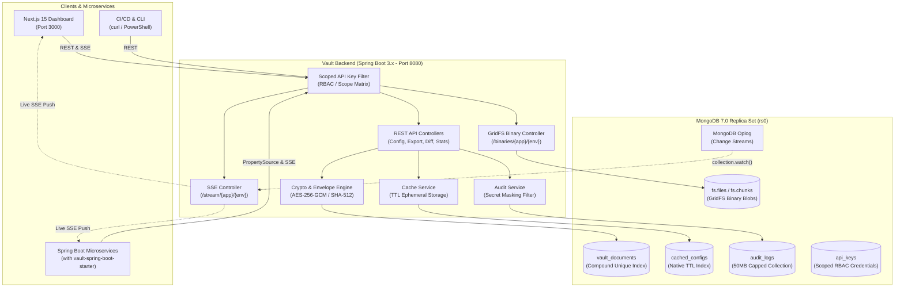
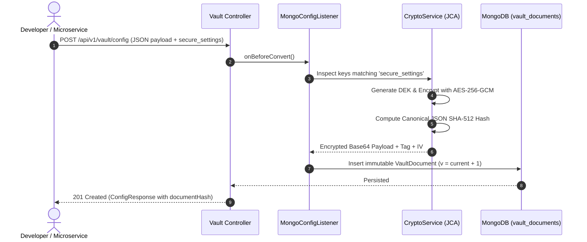
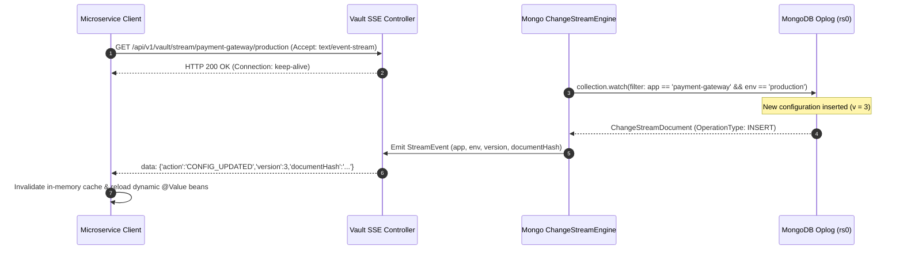

# 🛡️ Zero-Config Vault

> **Enterprise-Grade, GitOps-Style Configuration & Secret Management Engine**  
> Powered by MongoDB 7.0 Replica Sets, Spring Boot 3.x (Java 17 LTS), and Next.js 15.

[](https://zeroconfig-one.vercel.app)
[](https://zeroconfig-0s8m.onrender.com/swagger-ui.html)
[]()
[]()
[]()
[-black.svg)]()
[-red.svg)]()
[]()

---

## 📖 Table of Contents
1. [Overview](#-overview)
2. [Architectural Highlights](#-architectural-highlights)
3. [System Architecture Diagram](#-system-architecture-diagram)
4. [Advanced NoSQL & MongoDB Capabilities](#-advanced-nosql--mongodb-capabilities)
5. [Horizontal Sharding & Distributed Scalability](#-horizontal-sharding--distributed-scalability)
6. [Cryptographic & Security Blueprint](#-cryptographic--security-blueprint)
7. [GitOps Temporal Versioning & Delta Engine](#-gitops-temporal-versioning--delta-engine)
8. [Real-Time SSE & Change Streams](#-real-time-sse--change-streams)
9. [Spring Boot Client Starter](#-spring-boot-client-starter)
10. [Frontend Dashboard Architecture](#-frontend-dashboard-architecture)
11. [Quickstart: Docker Compose](#-quickstart-docker-compose)
12. [Local Development](#-local-development)
13. [REST API Catalog](#-rest-api-catalog)
14. [Automated Verification & Test Harness](#-automated-verification--test-harness)

---

## 🌟 Overview

**Zero-Config Vault** is an all-in-one centralized configuration management, secret injection, and binary payload storage plane designed for distributed microservices. Unlike legacy systems that require complex clusters of Consul, ZooKeeper, or Redis caches alongside a SQL store, Zero-Config Vault leverages **MongoDB as its sole, highly optimized data engine**.

It provides:
- **Zero External Caches**: MongoDB native TTL collections serve as an ultra-fast 5-minute ephemeral cache layer.
- **Auditable Capped Collections**: Append-only MongoDB circular logs prevent tampering and boundless disk growth.
- **GitOps-Style Immutability**: Every configuration modification increments a monotonic version number ($v_1 \to v_2 \to v_3$). Existing versions can never be mutated or overwritten in-place.
- **Hardware-Grade Cryptography**: Transparent field-level envelope encryption (AES-256-GCM + SHA-512 canonical verification) for sensitive payloads under `"secure_settings"`.
- **Zero Lombok Enforcement**: 100% explicit, transparent, auditable Java 17 bytecode designed for strict security audits.

---

## 🏛️ Architectural Highlights



---

## ⚡ Advanced NoSQL & MongoDB Capabilities

Zero-Config Vault pushes MongoDB 7.0 to its architectural limits by utilizing native database engine features that eliminate third-party caching, queuing, and search infrastructure:

### 1. MongoDB Native Time-Series Collections (`timeseries`)
Access telemetry is recorded in a native time-series collection (`config_access_telemetry`):
- **timeField**: `timestamp`
- **metaField**: `metadata` (`applicationName`, `environment`, `operation`, `clientIp`)
- **granularity**: `SECONDS`
Aggregated via MongoDB's high-speed bucketing pipelines to deliver sub-millisecond throughput analytics and cache hit efficiency metrics directly to the dashboard.

### 2. Engine-Level Schema Validation (`$jsonSchema`)
Structural governance is enforced directly at the MongoDB storage engine level via `$jsonSchema`:
- Mandatory presence of `applicationName`, `environment`, `version`, `documentHash`, and `payload`.
- Strict regex slug constraints and environment enum validation (`["development", "staging", "production", "dr"]`).
- Rejects corrupt or unauthorized direct database insertions with native MongoDB `DocumentValidationFailure` (Error Code 121).

### 3. Full-Text Search Index (`$text`)
MongoDB Full-Text text indexing on `{ applicationName: "text", searchableText: "text", environment: "text" }` powers instantaneous global search across thousands of configurations, returning matching key paths, deep links, and highlighted snippets.

---

## 🌐 Horizontal Sharding & Distributed Scalability

For full details on the multi-shard cluster design, refer to the **[MongoDB Sharding Blueprint](file:///d:/college/Sem/Sem%207/NoSQL%20Databases/Project/Zero-Config%20Vault/SHARDING.md)**.

- **Compound Shard Key**: `{ "applicationName": "hashed", "environment": 1 }`
- **Uniform Write Distribution**: MongoDB Murmur3 hashing guarantees even write dispersal without monotonic version hotspots.
- **Single-Shard Targeted Querying**: `mongos` dispatches operational reads directly to a single shard, eliminating scatter-gather broadcast overhead.
- **Zone Sharding**: Dedicated NVMe SSD shards for `production` configurations (`ZONE_PROD_TIER1`) isolated from commodity dev/staging nodes.

---

## 🔐 Cryptographic & Security Blueprint

### 1. Envelope Encryption (DEK & KEK)
Every configuration block containing sensitive keys is protected using an **Envelope Encryption** scheme:
- **Key Encryption Key (KEK)**: Stored in an environment-isolated root keystore or injected via `VAULT_MASTER_KEY` (AES-256-GCM).
- **Data Encryption Key (DEK)**: Ephemeral 256-bit cryptographically secure symmetric key generated per configuration revision.
- **Envelope Storage**: The encrypted configuration payload is stored with its encrypted DEK, IV/nonce, and authentication tag. Rotating the parent KEK only re-encrypts stored DEKs without touching the underlying payload documents.



### 2. SHA-512 Canonical Document Hashing
To prevent subtle JSON key ordering manipulation from altering cryptographic signatures:
1. Incoming JSON structures are parsed into canonical sorted representations.
2. Formatted through `MessageDigest.getInstance("SHA-512")`.
3. Hex-encoded into a 128-character immutable signature (`documentHash`).
4. Displayed with an **Integrity Verification Badge** on the frontend dashboard.

### 3. Dynamic Audit Log Secret Masking
Every mutation operation records an entry into the capped `audit_logs` collection. Sensitive configuration keys (`password`, `secret`, `token`, `key`, `private`, `credential`) are automatically masked in audit traces (e.g., `"password": "********"`), ensuring zero compliance leakage in persistent logs.

---

## ⏱️ GitOps Temporal Versioning & Delta Engine

1. **Strict Immutability**:
   A compound unique index on `{ applicationName: 1, environment: 1, version: 1 }` prevents overwriting past configurations.
2. **Atomic Rollback**:
   Executing `POST /api/v1/vault/config/{app}/{env}/rollback?targetVersion={target}` reads the exact snapshot of $v_{target}$, increments the monotonic version pointer to $v_{highest} + 1$, and writes a new immutable revision referencing the rollback origin.
3. **Dot-Notation Path Traversal**:
   Extract nested settings directly without transferring the entire payload:
   ```http
   GET /api/v1/vault/config/payment-gateway/production/path?path=server.ssl.protocol
   ```
   **Response**: `"TLSv1.3"`
4. **Structural Diffing (`/diff`)**:
   Deep structural delta comparison between any two version numbers ($v_1$ and $v_2$):
   ```json
   {
     "added": { "payment.gateways[3]": "apple_pay" },
     "removed": {},
     "modified": {
       "server.timeoutMs": { "oldValue": 5000, "newValue": 3000 }
     },
     "unchangedCount": 14
   }
   ```

---

## ⚡ Real-Time SSE & Change Streams

Zero-Config Vault eliminates polling loops through native **MongoDB Change Streams** hooked to **Server-Sent Events (SSE)**:



---

## 📦 Spring Boot Client Starter

The `starter/` directory contains `vault-spring-boot-starter`, a drop-in client library for Spring Boot microservices.

### 1. Maven Dependency
```xml
<dependency>
    <groupId>com.vault</groupId>
    <artifactId>vault-spring-boot-starter</artifactId>
    <version>1.0.0-SNAPSHOT</version>
</dependency>
```

### 2. Client Configuration (`application.yml`)
```yaml
vault:
  client:
    enabled: true
    server-url: http://localhost:8080
    api-key: sk-payment-service-key
    application-name: payment-gateway
    environment: production
    fail-fast: false
    sse:
      auto-refresh: true
```

### 3. Dynamic Property Binding
Properties stored in the vault seamlessly bind to Spring's `Environment` and standard `@Value` or `@ConfigurationProperties` annotations:
```java
@RestController
@RefreshScope
public class CheckoutController {

    @Value("${payment.rateLimitPerMinute:1000}")
    private int rateLimit;

    @Value("${secure_settings.stripe_api_secret}")
    private String stripeSecret; // Decrypted automatically by Vault on fetch
}
```
When a revision is committed in the vault, the starter's SSE listener receives the event and triggers Spring's `ContextRefreshedEvent` without restarting the JVM.

---

## 🎨 Frontend Dashboard Architecture

The Next.js 15 dashboard (`frontend/`) is crafted with high-density, production-ready enterprise ergonomics:
- **Typography**: Cormorant Garamond (refined headings) paired with Montserrat (high-legibility technical data).
- **Motion Accessibility**: All Framer Motion micro-interactions query `prefers-reduced-motion` and drop transitions to 0ms when active.
- **Interactive JSON Tree Editor**: Expandable node tree with type badges, envelope-encryption lock icons, and a raw JSON syntax validator.
- **Visual Git Timeline**: Git-style vertical commit spine with glow states, SHA-512 hashes, and quick-rollback triggers.
- **Delta Studio Diff Viewer**: Side-by-side and unified diff views with colorized added (**Green**), deleted (**Red**), and modified (**Yellow**) nodes.
- **Real-Time Telemetry Cards**: MongoDB aggregation pipeline metrics displaying environment counts, version distributions, audit log volume, and live oplog status.

---

## 🚀 Quickstart: Docker Compose

Bring up the complete ecosystem (MongoDB 7.0 Replica Set, Database Initializer, Spring Boot Backend, and Next.js 15 Frontend) with a single command:

```bash
docker compose up --build
```

### Container Endpoints:
| Service | URL | Credentials / Notes |
| :--- | :--- | :--- |
| **Frontend Dashboard** | `http://localhost:3000` | Pre-configured with dev API key |
| **Backend REST API** | `http://localhost:8080` | `X-API-Key: sk-dev-key-001` |
| **Swagger UI Interactive Docs** | `http://localhost:8080/swagger-ui.html` | Interactive REST testing |
| **OpenAPI Specification** | `http://localhost:8080/v3/api-docs` | Machine-readable API schema |
| **MongoDB Replica Set** | `localhost:27017` | Database: `secure_config_vault` (rs0) |

---

## 💻 Local Development

### Prerequisites
- **Java 17 LTS**
- **Maven 3.9+**
- **Node.js 20 LTS** & **npm**
- **MongoDB 7.0+** running locally as a replica set

### 1. Build and Run Backend
```bash
# In the root repository directory
mvn clean package -DskipTests
java -jar target/secure-config-vault-1.0.0-SNAPSHOT.jar
```

### 2. Run Starter Tests
```bash
cd starter
mvn test
```

### 3. Build and Run Frontend
```bash
cd frontend
npm install
npm run dev
# Dashboard accessible at http://localhost:3000
```

---

## 📡 REST API Catalog

All `/api/v1/vault/**` endpoints require an `X-API-Key` header.

### Configuration Management
| Method | Endpoint | Description |
| :--- | :--- | :--- |
| `POST` | `/api/v1/vault/config` | Create or update a configuration (increments version) |
| `GET` | `/api/v1/vault/config/{app}/{env}` | Get active (latest) configuration payload |
| `GET` | `/api/v1/vault/config/{app}/{env}/versions` | List all historical version summaries |
| `GET` | `/api/v1/vault/config/{app}/{env}/versions/{version}` | Get specific historical snapshot |
| `GET` | `/api/v1/vault/config/{app}/{env}/path?path=...` | Query nested value by dot-notation path |
| `GET` | `/api/v1/vault/config/search?query=...` | MongoDB Full-Text ($text index) & regex search |
| `POST` | `/api/v1/vault/config/{app}/{env}/rollback` | Atomically rollback to target version |
| `POST` | `/api/v1/vault/config/bulk?atomic=true` | Bulk import configs with ACID transaction |

### Version Control & Diffing
| Method | Endpoint | Description |
| :--- | :--- | :--- |
| `GET` | `/api/v1/vault/config/{app}/{env}/diff?v1={v1}&v2={v2}` | Structural delta between two versions |
| `GET` | `/api/v1/vault/export/{app}/{env}?format={json\|yaml\|env}` | Export configuration file |

### Real-Time Streaming & Binary Storage
| Method | Endpoint | Description |
| :--- | :--- | :--- |
| `GET` | `/api/v1/vault/stream/{app}/{env}` | Server-Sent Events (SSE) change stream pipe |
| `POST` | `/api/v1/vault/binaries/{app}/{env}` | Upload GridFS binary blob (TLS cert, keystore) |
| `GET` | `/api/v1/vault/binaries/{app}/{env}/download` | Download binary payload with content type |

### System Telemetry & Access Control
| Method | Endpoint | Description |
| :--- | :--- | :--- |
| `GET` | `/api/v1/vault/stats` | MongoDB aggregation pipeline system metrics |
| `GET` | `/api/v1/vault/stats/telemetry?minutes=...` | Native Time-Series request latency & cache ratio |
| `GET` | `/api/v1/vault/stats/schema` | Engine-level MongoDB $jsonSchema validation rules |
| `POST` | `/api/v1/vault/keys` | Create scoped API key (Requires `ADMIN` role) |
| `GET` | `/api/v1/vault/keys` | List active scoped API keys (`ADMIN` role) |

---

## 🧪 Automated Verification & Test Harness

Zero-Config Vault includes automated cross-platform test scripts for local integration testing (kept locally on developer machines and git-ignored to prevent credential exposure):

### Run via PowerShell (Windows Local Harness)
```powershell
.\verify-vault.ps1
```

### Run via Bash (Linux / macOS Local Harness)
```bash
chmod +x ./verify-vault.sh
./verify-vault.sh
```

### The Verification Suite Tests:
1. **API Gateway & Swagger Health** (HTTP 200 checks).
2. **Security & Authentication** (401 on missing key, 403 on role mismatch).
3. **Cryptographic Engine** (Field-level encryption of `secure_settings` in DB).
4. **Temporal Revisions** (Monotonic increment $v_1 \to v_2$).
5. **Delta Engine** (Structural key diffing calculation).
6. **Atomic Rollback** ($v_2 \to v_3$ matching $v_1$ snapshot).
7. **GridFS Binary Engine** (Upload and byte-for-byte binary download).
8. **Aggregation Pipeline** (Real-time telemetry calculation).
9. **Capped Audit Logs** (Verification of sensitive field masking).
