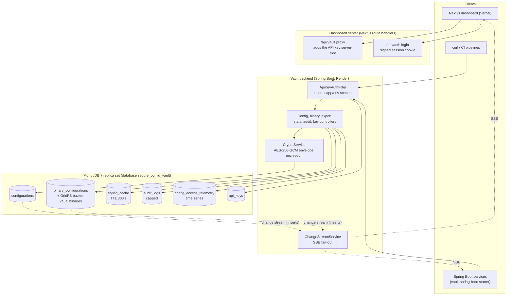

# Zero-Config Vault

A configuration and secret store for microservices, built with MongoDB as its only data store. Every change creates a new immutable version. Secrets are encrypted before they reach the database, and connected services and dashboards receive changes live.

- **Live dashboard:** https://zeroconfig-one.vercel.app (guest access by default; admin after login)
- **Backend API:** https://zeroconfig-0s8m.onrender.com/swagger-ui.html (free Render instance; the first request after idle can take a minute)
- **Stack:** Java 17, Spring Boot 3.2.5, Spring Data MongoDB, MongoDB 7 (Atlas M0 in production, a single-node replica set locally), Next.js 15.5 with React 19, and a Spring Boot client starter.

## Contents

1. [What it does](#what-it-does)
2. [Architecture](#architecture)
3. [MongoDB features used](#mongodb-features-used)
4. [Versioning, rollback and retention](#versioning-rollback-and-retention)
5. [Security](#security)
6. [Live updates](#live-updates)
7. [Bulk import](#bulk-import)
8. [Dashboard](#dashboard)
9. [Spring Boot client starter](#spring-boot-client-starter)
10. [Running locally](#running-locally)
11. [Tests](#tests)
12. [Deploying](#deploying)
13. [REST API](#rest-api)
14. [Further documents](#further-documents)

## What it does

- Stores JSON configuration per application and environment. Every write creates a new version; existing versions are not edited.
- Encrypts every value under a `secure_settings` key with AES-256-GCM envelope encryption before it is stored.
- Shows secrets only to API keys with the `REVEAL_SECRETS` permission; everyone else sees `********`.
- Rolls back by copying an old version into a new one, and compares any two versions key by key.
- Pushes each new version to subscribers over Server-Sent Events, sourced from a MongoDB change stream.
- Imports many configurations at once, optionally all-or-nothing in a multi-document transaction.
- Stores binary files such as certificates and keystores in GridFS, with their own versions.
- Exports a configuration as JSON, YAML or `.env`.
- Records every operation in a capped audit log, and the latency of reads and writes in a time-series collection.

## Architecture



The browser never holds an API key. The dashboard's server-side proxy attaches the guest or admin key according to the signed session cookie, and blocks writes for guests outside the `playground` application.

## MongoDB features used

| Feature | Where | What it does here |
| :--- | :--- | :--- |
| Compound unique index | `configurations` `{applicationName, environment, version}` | Two writers cannot create the same version; the loser gets `409 Conflict`. |
| `$jsonSchema` validator | `configurations` | Requires `applicationName`, `environment`, `version`, `documentHash`, `payload` and `createdAt`; the application name must match `^[a-zA-Z0-9_-]+$`, and the environment must be one of `development`, `staging`, `production`, `dr`. Invalid direct inserts fail with error code 121. |
| TTL index (exact date) | `configurations.expiresAt`, `expireAfterSeconds: 0` | Deletes old superseded versions on the date stored in each document (see retention below). |
| TTL index (fixed age) | `config_cache.cachedAt`, 300 s | Read cache that expires after 5 minutes, so no Redis is needed. |
| Capped collection | `audit_logs`, 50 MB / 10,000 documents | Append-only audit trail that discards its oldest entries automatically. |
| Time-series collection | `config_access_telemetry` (`timeField: timestamp`, `metaField: metadata`, granularity seconds) | Latency, cache hits and status codes per application, environment, operation and client IP. |
| Text index | `configurations` on `applicationName`, `searchableText`, `environment` | Global search. `searchableText` holds key paths and non-secret values only. |
| Aggregation (`$facet`, `$group`, `$bsonSize`) | `GET /stats` | Counts per environment and application, and stored size per document. |
| Change streams | database-level watch on `configurations` and `binary_configurations` | Exactly one live event per new version, with resume tokens. |
| Multi-document transactions | `POST /config/bulk?atomic=true` | All-or-nothing bulk import. |
| GridFS | bucket `vault_binaries` | Binary files of any size, stored in chunks. |

Sharding is designed but not deployed (Atlas M0 does not support it). See [SHARDING.md](SHARDING.md).

## Versioning, rollback and retention

- **New versions only.** A create, a partial update (`PATCH`), a rollback or a bulk import inserts a new document with the next version number. The payload of an existing version is never changed.
- **Rollback.** `POST /config/{app}/{env}/rollback/{version}` copies the stored payload of the target version into a new version, tagged `rollback_from_version`. The history therefore shows the rollback as its own step.
- **Diff.** `GET /config/{app}/{env}/diff?v1=1&v2=3` returns `added`, `removed`, `modified` (each with `oldValue` and `newValue`) and `unchangedCount`, keyed by dot-notation path.
- **Retention.** The current version and the 5 most recent superseded versions are always kept. An older version gets an `expiresAt` date 90 days after it falls out of that window, and MongoDB's TTL monitor deletes it on that date. Both numbers are settings (`vault.version.retain-count`, `vault.version.expiry-days`). An `expiry-days` of 0 or less turns expiry off and clears pending dates. Binary versions are not subject to retention.

## Security

- **Envelope encryption.** Every value under a `secure_settings` key, at any depth, is encrypted with AES-256-GCM using its own random 256-bit data key. The data key is itself encrypted with the master key from `VAULT_MASTER_KEY`, and stored next to the ciphertext with its IV. Outside the dev profile the backend refuses to start without a strong master key. `CryptoService.reEncryptDek` can re-wrap a data key under a new master key, but there is no key-rotation endpoint yet.
- **No plaintext at rest.** Searchable text, the cache and audit entries never contain decrypted secrets. On startup, `PlaintextRemediationRunner` encrypts any plaintext secret left by older builds.
- **Pre-encrypted input is refused.** A client cannot submit a value that already looks like an encrypted envelope. Such a request gets `400 Bad Request`, for example `secure_settings.password must be a plain value; encrypted envelopes cannot be submitted`.
- **Integrity hash.** Each version stores a SHA-512 hash of its canonical (key-sorted) JSON payload, computed over the encrypted form. Reads recompute it and answer `409 Conflict` if the document was altered.
- **API keys.** Keys are sent in the `X-API-Key` header. The database stores only a SHA-256 hash of each key and a short display prefix. Each key has roles and may be limited to certain applications and environments.

  | Role | Allows |
  | :--- | :--- |
  | `READ` | `GET` requests in the key's scope |
  | `WRITE` | `POST`, `PATCH`, `PUT` and `DELETE` in the key's scope |
  | `ROLLBACK` | rollback endpoints |
  | `EXPORT` | export endpoints |
  | `REVEAL_SECRETS` | decrypted secret values in responses |
  | `ADMIN` | everything, including `/keys` and the global change stream |

- **Masking.** Without `REVEAL_SECRETS`, secret values are replaced with `********` in reads, history, diffs, exports, path queries and the audit log. Any request can also ask for masking with `?masked=true`. When a client saves a payload that still contains `********`, the stored secret is kept.
- **Dev keys.** The keys `sk-dev-key-001`, `sk-dev-guest-read` and `sk-dev-guest-sandbox` exist only with the `dev` Spring profile. In any other profile they are deactivated at startup.

## Live updates

- `GET /api/v1/vault/stream/{app}/{env}` opens a Server-Sent Events stream. It sends an `INIT` event on connect, then one `CONFIG_CHANGE` event per new version with `eventType` (`CREATE` or `ROLLBACK`), `applicationName`, `environment`, `version`, `documentHash` and `timestamp`.
- `GET /api/v1/vault/stream` (admin only) streams changes for every application.
- The events come from a single MongoDB change stream that watches inserts into `configurations` and `binary_configurations`. Updates (retention marking) and deletes (TTL expiry) produce no events.
- After a dropped connection the backend resumes from its last resume token, retrying every 1 s up to every 30 s. If the token is no longer valid it restarts from the current time and logs a warning.
- If change streams are not available at startup (a standalone MongoDB), the backend runs in fallback mode for its lifetime and broadcasts from the write path instead. The log line `Live events run in CHANGE_STREAM mode` or `FALLBACK mode` shows which one is active.

## Bulk import

`POST /api/v1/vault/config/bulk` takes `{"configs": [ {applicationName, environment, payload, tags}, ... ]}`.

- **Best effort (default).** Each entry is saved on its own; the response lists which entries failed and why.
- **Atomic (`?atomic=true`).** All inserts run in one MongoDB transaction. If any entry fails validation, nothing is stored, the response is `422`, and a `BULK_IMPORT_ROLLBACK` audit entry is written. Cache eviction, retention, audit entries and live events happen only after the transaction commits. Against a MongoDB that does not support transactions, the request fails with `422` and "atomic bulk import requires a replica set" rather than silently running best effort.

## Dashboard

The dashboard (`frontend/`) has these pages: `/dashboard` (statistics and telemetry), `/configs` (payload tree editor, version timeline, rollback, integrity badge), `/diff` (split and unified diff), `/binaries` (GridFS files), `/export`, `/audit` (recent audit entries, refreshed on each live event), `/access` (API key management) and `/nosql` (the MongoDB features above).

- **Guest (default).** Reads every application. Writes and rollbacks are allowed only in the `playground` application, so visitors can try the editor without changing the demo data. Secrets stay masked.
- **Admin (after login).** Full access, including revealed secrets and key management.

The design uses Cormorant Garamond, Montserrat and JetBrains Mono, Tailwind CSS 4, Framer Motion (animations respect `prefers-reduced-motion`) and a Three.js hologram on the landing page.

## Spring Boot client starter

`starter/` builds `com.vault:vault-spring-boot-starter:1.0.0-SNAPSHOT`, a library that loads a service's configuration from the vault at startup.

```yaml
vault:
  uri: http://localhost:8080
  application-name: payment-gateway   # defaults to spring.application.name
  environment: production             # defaults to the first active profile
  api-key: <key with READ and REVEAL_SECRETS>
  fail-on-error: false                # true stops startup if the vault is unreachable
  stream-enabled: true                # subscribe to live changes
  timeout: 5000                       # milliseconds
```

- At startup the starter fetches `GET /api/v1/vault/config/{app}/{env}` and adds the payload to the Spring `Environment` as dot-notation properties, for example `secure_settings.stripe_api_secret`. They work with `@Value` and `@ConfigurationProperties`.
- The vault's properties are added with the lowest precedence, so a value in the service's own `application.yml` wins.
- The key needs `READ` and `REVEAL_SECRETS`. Without `REVEAL_SECRETS` the service would receive the literal `********`.
- With `stream-enabled: true`, the starter listens to the SSE stream and publishes a `VaultConfigRefreshedEvent` for each message. The service decides how to react, for example with an `@EventListener` that reloads its settings. The starter does not refresh beans by itself.

## Running locally

### Everything with Docker Compose

```bash
docker compose up --build
```

| Service | Address | Notes |
| :--- | :--- | :--- |
| Dashboard | http://localhost:3000 | Guest by default; the admin password is `admin` (local only) |
| Backend | http://localhost:8080 | Runs with the `dev` profile; admin key `sk-dev-key-001` |
| Swagger UI | http://localhost:8080/swagger-ui.html | |
| OpenAPI | http://localhost:8080/v3/api-docs | |
| MongoDB | localhost:27017 | Replica set `rs0`, database `secure_config_vault` |

The `mongo` container initialises the replica set, and `docker/init-mongo.js` creates the capped audit and time-series collections. Indexes, the validator, demo data and API keys are created by the backend on startup.

### Backend and frontend by hand

Prerequisites: Java 17, Maven 3.9+, Node.js 20+, and MongoDB 7 running as a replica set on `localhost:27017` (a standalone server works, but then live events use fallback mode and atomic bulk import is refused).

```bash
# Backend, from the repository root
mvn clean package -DskipTests
java -jar target/secure-config-vault-1.0.0-SNAPSHOT.jar --spring.profiles.active=dev
```

The `dev` profile seeds the well-known development keys and accepts a published development master key. Never run it against the production database: it would reactivate the published keys as admin keys.

```bash
# Frontend
cd frontend
cp .env.example .env.local   # defaults match the dev keys
npm install
npm run dev                  # http://localhost:3000
```

| Variable (server only) | Local value | Purpose |
| :--- | :--- | :--- |
| `VAULT_API_URL` | `http://localhost:8080` | Backend base URL |
| `VAULT_GUEST_READ_KEY` | `sk-dev-guest-read` | Key used for guest reads |
| `VAULT_GUEST_SANDBOX_KEY` | `sk-dev-guest-sandbox` | Key used for guest writes (playground only) |
| `VAULT_ADMIN_KEY` | `sk-dev-key-001` | Key used after admin login |
| `ADMIN_PASSWORD` | `admin` | Admin login password |
| `SESSION_SECRET` | any 64 hex characters | Signs the session cookie; at least 32 random bytes |

No `NEXT_PUBLIC_VAULT_*` variable is used; the browser never receives an API key.

## Tests

| Command | Runs |
| :--- | :--- |
| `mvn test` | Backend unit tests and integration tests (`*IT.java`) |
| `mvn -f starter/pom.xml test` | Starter tests |
| `cd frontend && npm test` | Frontend tests (session, proxy policy, API client) |

The backend integration tests start a real MongoDB 7.0 replica set with Testcontainers. They cover retention and TTL deletion, live events, atomic bulk import and encryption at rest. They need Docker and are skipped when Docker is not available. The first run downloads the `mongo:7.0` image.

## Deploying

The backend runs on Render and the frontend on Vercel. Both deploy automatically when `main` changes. In production the dev profile is off and the development keys are refused.

**Production variables**

| Where | Variable | Notes |
| :--- | :--- | :--- |
| Render | `SPRING_DATA_MONGODB_URI` | Atlas connection string |
| Render | `VAULT_MASTER_KEY`, `VAULT_BOOTSTRAP_ADMIN_KEY` | The master key encrypts the data keys; the bootstrap key seeds the first admin key |
| Vercel (server only) | `VAULT_API_URL` | Render base URL |
| Vercel (server only) | `VAULT_GUEST_READ_KEY`, `VAULT_GUEST_SANDBOX_KEY`, `VAULT_ADMIN_KEY` | Keys created with `POST /keys` |
| Vercel (server only) | `ADMIN_PASSWORD`, `SESSION_SECRET` | `SESSION_SECRET` is at least 32 random bytes |

**First deployment**

1. Render: set `VAULT_MASTER_KEY` and `VAULT_BOOTSTRAP_ADMIN_KEY`. If the master key differs from the one that encrypted the existing Atlas data, empty the demo collections so the seeder can reseed them.
2. Merge to `main`; Render and Vercel both deploy.
3. With the bootstrap admin key, create the guest-read, guest-sandbox and admin keys via `POST /keys`.
4. Vercel: set the server-only variables and redeploy.
5. Check that no key appears in the built frontend bundle, and that the guest and admin flows work on the live site.

**After deploying**

- Revoke the bootstrap admin key once the three dashboard keys exist.
- Use a long random `ADMIN_PASSWORD`; the login endpoint is not rate-limited.
- Open the site about 2 minutes before a demo so the Render instance is awake. A cold start can take longer than the proxy's 60-second limit.
- Check the backend log for `Live events run in CHANGE_STREAM mode` and the absence of `Could not ensure expiresAt TTL index`. `db.configurations.getIndexes()` should list the `expiresAt` index with `expireAfterSeconds: 0`.

**Rolling back to an older build**

Builds before the retention change declare the `expiresAt` index with `expireAfterSeconds: 7776000` (90 days) and fail at startup with `IndexOptionsConflict` against the current index. Before redeploying such a build, restore the old setting with a user that has the `collMod` privilege, or drop the index and let the old build recreate it:

```js
db.runCommand({collMod: "configurations", index: {keyPattern: {expiresAt: 1}, expireAfterSeconds: 7776000}})
```

## REST API

All endpoints under `/api/v1/vault` need an `X-API-Key` header, except that the stream and binary download endpoints also accept `?apiKey=` on `GET` (for `EventSource` and download links). Swagger UI lists the request and response schemas.

**Configurations** (`/api/v1/vault/config`)

| Method | Path | Description |
| :--- | :--- | :--- |
| `POST` | `/config` | Create a new version (`applicationName`, `environment`, `payload`, `tags`) |
| `PATCH` | `/config/{app}/{env}` | Merge a partial payload into the latest version, as a new version |
| `GET` | `/config/{app}/{env}` | Latest version (`?masked=true` to mask secrets) |
| `GET` | `/config/{app}/{env}/versions` | Version history |
| `GET` | `/config/{app}/{env}/version/{version}` | One version |
| `GET` | `/config/{app}/{env}/diff?v1=&v2=` | Differences between two versions |
| `GET` | `/config/{app}/{env}/search?path=a.b.c` | Value at a dot-notation path |
| `POST` | `/config/{app}/{env}/rollback/{version}` | New version with the content of `{version}` (`ROLLBACK` role) |
| `GET` | `/config/{app}/{env}/export?format=json\|yaml\|env` | Export (`EXPORT` role); also at `/export/{app}/{env}` |
| `GET` | `/config/search?query=` | Full-text search across all configurations |
| `POST` | `/config/bulk?atomic=true\|false` | Bulk import |

**Binary files** (`/api/v1/vault/binaries`)

| Method | Path | Description |
| :--- | :--- | :--- |
| `POST` | `/binaries/{app}/{env}/upload` | Upload a file (multipart field `file`); each upload of the same file name is a new version |
| `GET` | `/binaries/{app}/{env}` | List files |
| `GET` | `/binaries/{app}/{env}/{filename}?version=` | Download (latest version by default) |
| `GET` | `/binaries/{app}/{env}/{filename}/versions` | Version history |
| `POST` | `/binaries/{app}/{env}/{filename}/rollback/{version}` | New version with the content of `{version}` |

**Live events, statistics, audit and keys**

| Method | Path | Description |
| :--- | :--- | :--- |
| `GET` | `/stream/{app}/{env}` | SSE stream for one application and environment |
| `GET` | `/stream` | SSE stream for all applications (`ADMIN`) |
| `GET` | `/stats` | Aggregated counts and sizes |
| `GET` | `/dashboard` | Dashboard summary |
| `GET` | `/stats/telemetry?minutes=60` | Time-series latency and cache hits |
| `GET` | `/stats/schema` | The active `$jsonSchema` rules |
| `GET` | `/audit?limit=50&app=&env=` | Recent audit entries |
| `POST` | `/keys` | Create an API key (`ADMIN`); the raw key is returned once |
| `GET` | `/keys` | List keys (`ADMIN`) |
| `PATCH` | `/keys/{id}/revoke` | Deactivate a key (`ADMIN`) |
| `DELETE` | `/keys/{id}` | Delete a key (`ADMIN`) |

## Further documents

- [SPEC.md](SPEC.md): system specification (components, data model, behaviour).
- [DECISIONS.md](DECISIONS.md): architectural decisions and their reasons.
- [SHARDING.md](SHARDING.md): how the `configurations` collection would be sharded at scale.
