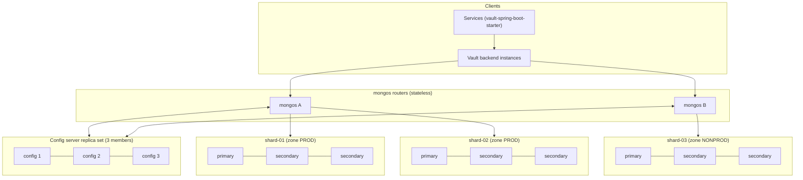

# Sharding Design for Zero-Config Vault

**Status:** design only. The live system runs on a single MongoDB replica set (Atlas M0, which does not support sharding; Atlas offers sharded clusters from the M30 tier). This document describes how the vault would be sharded if it had to serve a very large fleet of services, and which parts of the current design would need to change.

## Why shard at all

A configuration vault is read far more often than it is written: every service instance reads its configuration at startup and on each change. Writes come in bursts when many services are deployed at once. On a single replica set, the primary takes every write and the working set must fit in one machine's memory. Sharding spreads both the data and the write load across several replica sets.

For the current data volume (a few hundred versions) sharding is not needed; a single replica set is the right choice.

## Cluster layout



- The backend connects to the `mongos` routers instead of a replica set; no application code changes are needed for reads and writes.
- The config servers form a three-member replica set. Config server replica sets cannot contain arbiters.
- Each shard is itself a three-member replica set, so transactions and change streams keep working.

## Shard key for `configurations`

```javascript
sh.shardCollection("secure_config_vault.configurations",
  { environment: 1, applicationName: "hashed" })
```

| Requirement | How this key meets it |
| :--- | :--- |
| Reads hit one shard | Services always read by `applicationName` and `environment`. Both fields are in the key, so `mongos` sends the query to exactly one shard. |
| Writes spread out | The hashed `applicationName` spreads applications evenly across the chunks of each environment, regardless of naming. |
| No write hotspot | `version` increases monotonically, so it is deliberately not part of the key; a key on `version` would send every new write to the same chunk. |
| Zones per environment | `environment` is the key's prefix, so ranges of the key can be assigned to zones by environment (below). |
| Enough distinct values | Chunks are split on the hashed application name, so the number of chunks is not limited by the four environments. |

Alternatives rejected:

- `{ applicationName: "hashed", environment: 1 }`: good distribution, but a zone range for one environment would span almost the whole key space, because zone ranges follow the key's field order and the hashed field comes first.
- `{ version: 1 }` or `{ createdAt: 1 }`: monotonic, every insert lands in the last chunk.
- `{ _id: "hashed" }`: even distribution, but every configuration read would be sent to all shards.

## Zones: production on dedicated shards

```javascript
sh.addShardToZone("shard-01", "PROD");
sh.addShardToZone("shard-02", "PROD");
sh.addShardToZone("shard-03", "NONPROD");

sh.updateZoneKeyRange("secure_config_vault.configurations",
  { environment: "production", applicationName: MinKey },
  { environment: "production", applicationName: MaxKey },
  "PROD");

sh.updateZoneKeyRange("secure_config_vault.configurations",
  { environment: "development", applicationName: MinKey },
  { environment: "development", applicationName: MaxKey },
  "NONPROD");

sh.updateZoneKeyRange("secure_config_vault.configurations",
  { environment: "staging", applicationName: MinKey },
  { environment: "staging", applicationName: MaxKey },
  "NONPROD");
```

The `dr` environment would get its own zone, ideally on shards in another region.

Benefits:

- Production configuration lives on hardware that development and staging traffic cannot slow down.
- Non-production shards can use cheaper hardware.
- Production data can be kept in a specific region or on encrypted storage to meet compliance rules.

## Query routing

- **Targeted (the common case):** `GET /config/payment-gateway/production` filters on both shard-key fields, so `mongos` routes it to the single shard that owns that chunk.
- **Within one environment:** a query on `environment` alone goes only to that environment's zone.
- **Scatter-gather:** the dashboard statistics (`$facet` over all configurations), global text search and the global change stream have no shard-key filter and go to every shard. They are infrequent dashboard and admin operations, so their cost does not affect service reads.

## Other collections

| Collection | Plan | Reason |
| :--- | :--- | :--- |
| `audit_logs` | not sharded | Capped collections cannot be sharded. It stays on the database's primary shard; at larger scale the audit trail would move to a sharded normal collection with a TTL index, or to an external log store. |
| `config_access_telemetry` | shard on `{ "metadata.applicationName": 1, timestamp: 1 }` | Time-series collections can be sharded on the meta field and time. |
| `vault_binaries.chunks` | shard on `{ files_id: 1, n: 1 }` | The standard GridFS chunk key keeps each file's chunks together. |
| `binary_configurations`, `config_cache`, `api_keys` | not sharded | Small collections; sharding them would add routing cost without benefit. |

## Changes the current design would need

- **Unique version index.** On a sharded collection, a unique index must start with the shard key fields. The index `{applicationName, environment, version}` would be recreated as `{environment, applicationName, version}`. Whether MongoDB accepts this as unique while `applicationName` is hashed in the shard key must be confirmed on the target version before sharding. If it is not accepted, the duplicate-version check would have to move into the write path: a conditional insert, or a retry on conflict.
- **Text index.** It still works, but every text search becomes a scatter-gather query.
- **Change streams and transactions.** Both work through `mongos` on a sharded cluster. Transactions that touch several shards (a bulk import across environments) are slower than single-shard ones.
- **Retention.** The retention `updateMany` and the TTL monitor run per shard without changes.

## Balancing

Since MongoDB 6.0 the balancer moves ranges to even out the data size per shard, and the default range (chunk) size is 128 MB. Ranges are no longer split automatically on insert. Zones constrain where each range may live, and the balancer respects them.
